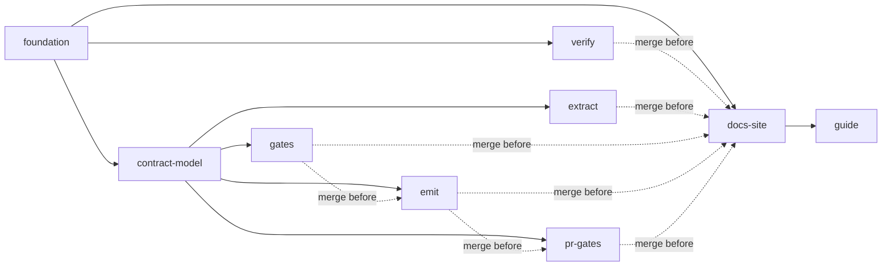

# Rewrite vector in Nish

## Context

vector is about 21k lines of TypeScript on Bun, with about 840 tests, in two tracks:

- **Verified functions** (about 4k lines). The `vector` skill writes a SpecPlan and a Program. `vector --verify` proves them with Z3 and emits guarded TypeScript. `--diff` compares program generations.
- **Spec to contract to Nish test** (about 14k lines). The `vector-spec` skill writes a kramdown-rfc spec. `vector spec extract|check|emit|run|frozen|stale|exports|mutate` turn it into a contract, gate it, and test nish's std against it.

Z3 is a subprocess (`z3 -in`, one script per call). The other external processes are nish, git and `sh -c`. Docs are a 2,181-line README.

The rewrite is a fresh design in Nish, not a line-by-line port. The old code stays readable at the base commit: `git show 06d3cec:src/<path>`. Workers read it for behaviour, edge cases and test cases, not for structure.

## Approach

| Decision | Choice | Why |
|---|---|---|
| Where | In place in amritk/vector. Foundation deletes the TypeScript, and later stages fill the command line back in | One codebase from the first merge. `main` loses features until each stage lands, and that is accepted for a 0.x tool |
| Compiler | nish **0.39.0**, pinned in `scripts/fetch-nish.sh`, installed to `.nish/` with nish's `install.sh`. Bumping it is its own PR | 0.39.0 adds what this tool leans on: `spawnPipedWithin` (a captured run with a deadline), function references in fields, arrays and `Map` values (gate and command tables), typed JSON tagged unions (the `Expr` and clause unions), object spread, and `split` with a limit |
| File formats | `schemas/spec-plan.json`, `program.json` and `rfc-contract.json` are unchanged, and so are the committed specs and contracts | The skills, the committed contracts and nish's `contracts/hex.json` keep working. Asked at sign-off |
| Command line | Subcommands: `vector verify`, `vector diff`, `vector spec <cmd>`. Exit codes stay 0 (pass), 1 (refused), 2 (usage or I/O) | The flag modes were an accident of history |
| Dropped | The 14 language tables and the README render (nothing used them), `--fixture`, `--spec/--program` aliases, the `rfc` alias, the embedded z3 tarball with z3cache and `--licenses`, `scripts/spec-stale.mjs`, mjst-generated code, Bun | Each is unused or exists only because of the Bun binary |
| Float64 gate | Interpret the AST in Nish `f64`. A test runs the emitted TypeScript under node on the same inputs and pins that the two agree | The old gate compiled the emitted code at runtime with `Bun.Transpiler` and `new Function`, which a native binary cannot do |
| Z3 | `$VECTOR_Z3`, then `.z3/z3`, then `z3` on PATH. One process per script, with the whole script on stdin | Same behaviour, with no binary to embed |
| Docs | A Scalar site from `scalar.config.json`, with a reference generated by TypeDoc and a generator, as nish does | The user asked for it |

## Rules carried over from nish

Foundation writes these into `CLAUDE.md`, and every stage follows them from its first commit:

- Commit subjects are conventional (`feat(spec): …`) and become the changelog. `pr-title.yml` checks the PR title.
- Every exported declaration has a doc comment, a `@param` per parameter and a `@returns` for a non-void return. The generated reference fails on a gap, and its undocumented list only shrinks.
- Generated files (`docs/reference/**`, the reference routes in `scalar.config.json`, `contracts/*.json`, `specs/*.xml`) are regenerated, never edited or hand-merged.
- Read a check's exit status, never its piped tail.
- A change a user sees updates its guide page in the same PR (this applies once the guide stage lands).
- Moving where a fact lives moves every pointer to it in the same PR.
- Nish specifics from `docs/AI.md`: function names are unique program-wide, so prefix helpers per module. No `throw`; use `Result`. State lives in a context class, not in module `let`. Run the compiler instead of reasoning about what is legal.

## The command line

`src/main.ts` builds the command tree with `nish/cli-args`. Each command lives in `src/cli/<command>.ts` and exports `register<Command>(cli)`, which declares its own flags and handler. Foundation creates every file as a stub that exits 2 with `not implemented yet`, so that no two stages edit `main.ts`.

| Command | Stage | Behaviour (as today unless noted) |
|---|---|---|
| `vector verify <spec.json> <program.json> [--json] [--emit f]` | verify | PROVEN exits 0, anything else exits 1. `--emit` writes only when PROVEN |
| `vector diff <old.json> <new.json> [--json]` | verify | 0 EQUIVALENT, 1 DIFFERENT or UNDECIDED, 2 invalid |
| `vector spec extract <spec.xml> [-o c.json] [--check]` | extract | Byte-identical canonical output, `file:line` refusals |
| `vector spec check <contract> [--run-sources] [--module f\|--nish-root d] [--format text\|markdown\|json]` | gates | |
| `vector spec emit <contract> -o <test.ts>` | emit | |
| `vector spec run <contract> --nish-root <d> [--format …]` | emit | |
| `vector spec frozen [contracts…] --base <ref>` | pr-gates | |
| `vector spec stale <test.ts> <contract>` | pr-gates | |
| `vector spec exports <contract> --nish-root <d> --base <ref>` | pr-gates | |
| `vector spec mutate <contract> --nish-root <d> --base <ref> [--jobs N --max N]` | pr-gates | |
| `vector --version`, `vector --help` | foundation | |

## Tests and the coverage gate

Nish has no coverage tool, so the 91% line-coverage floor cannot carry over. It is replaced by:

- **Unit tests**: `tests/<area>/**/*_test.ts`, which are Nish programs using `nish/testing` `Suite`, run with `nish run`.
- **CLI golden cases**: `tests/cli/<case>/` with `cmd`, `stdout`, `stderr` (optional) and `exit`, run against `dist/vector`.
- **`npm run tested-exports`** (`scripts/tested-exports.mjs`): fails when an exported function under `src/` is not called by name in any file under `tests/`. It is function-level coverage by reference: weaker than line coverage, but it is a command with an exit code.
- `node tests/run.mjs [filter]` runs every test whose path contains the filter. `npm test` runs them all.
- Fixtures a stage adds live under its own `tests/<area>/` directory, so concurrent stages never write the same path. The existing fixtures move once, by foundation, to `tests/fixtures/` and are read-only afterwards.
- Each stage carries over the behaviours that the old tests pinned for its area (`git show 06d3cec:test/<file>`), as Nish tests or CLI golden cases.

## Foundation

Owns: `src/**` (it deletes all of it, then writes `src/main.ts`, `src/core/**` and the `src/cli/*.ts` stubs), `test/**`, `tests/run.mjs`, `tests/core/**`, `tests/cli/**`, `tests/fixtures/**`, `scripts/*.ts`, `scripts/fetch-nish.sh`, `scripts/fetch-z3.sh`, `scripts/tested-exports.mjs`, `package.json`, `package-lock.json`, `bun.lock`, `tsconfig.json`, `biome.json`, `.gitignore`, `.github/workflows/ci.yml`, `.github/workflows/pr-title.yml`, `.claude/hooks/**`, `.claude/settings.json`, `CLAUDE.md`, `README.md`, `THIRD_PARTY_NOTICES.md`

- `src/core`: files and paths (join, dirname, recursive mkdir, temp dirs; nish has none of these), JSON helpers over `nish/json-value`, hex and sha256, `runProcess(argv, stdin, timeoutMs)` over `spawnPipedWithin`, and `runZ3(script)`, which keeps the `@@Q<i>` echo markers and the s-expression and rational reader from `git show 06d3cec:src/solve/runner.ts` and `smt.ts`.
- `package.json` keeps npm as the task runner: `build`, `test`, `lint` (biome), `tested-exports`. It adds `typedoc` and `typescript` as devDependencies now, so that docs-site does not need to touch the file.
- `ci.yml` has a `check` job: fetch nish and z3, build, `npm test`, lint, tested-exports, and a smoke run of `dist/vector --version`.
- The session hook installs nish and z3 if they are missing, and exports their paths.

## Verify

Owns: `src/verify/**`, `src/cli/verify.ts`, `src/cli/diff.ts`, `tests/verify/**`, `tests/cli/verify-*/**`, `tests/cli/diff-*/**`, `schemas/spec-plan.json`, `schemas/program.json`, `.claude/skills/vector/**`

Reference: `git show 06d3cec:src/{verify.ts,lang/,solve/,emit/,report/,diff.ts}`. The JSON outcome keeps the fields the skill reads: `status`, `feedback`, `items[]` (`function`, `axiomId`, `property`, `issue`, `counterexample`, `hint`), `errors[]`, `message`, `dashboard`, `emittedCode`, `styleWarnings`. The currency fixture proves and its emitted TypeScript matches the README excerpt. The unsat fixture is REFUTED with a counterexample.

## Contract model

Owns: `src/spec/contract/**`, `src/spec/source/**`, `src/spec/check.ts`, `tests/spec/contract/**`, `tests/spec/source/**`, `schemas/rfc-contract.json`

Reference: `contract.ts`, `vocab.ts`, `literals.ts`, `rfctext.ts`, `spectext.ts` and `sources.ts` under `git show 06d3cec:src/rfc/`. `check.ts` exports `checkContract(ctx, contract): CheckReport`, which runs a registered list of gates. Only the shape gate is registered here. It also defines the `Sample` table type that emit consumes.

## Extract

Owns: `src/spec/xml/**`, `src/spec/front/**`, `src/spec/profile/**`, `src/spec/extract.ts`, `src/cli/spec-extract.ts`, `tests/spec/extract/**`, `tests/cli/extract-*/**`, `.github/workflows/spec.yml`, `scripts/build-spec.sh`, `specs/**`, `contracts/**`, `rfcs/**`, `.refcache/**`

Extract calls `checkContract`. It gains the real gates automatically when the gates stage registers them. The proof is that the three committed contracts come out byte for byte. `spec.yml` brings back the old `spec-xml-drift` job and the `extract --check` loop.

## Gates

Owns: `src/spec/gates/**`, `src/spec/sample/**`, `src/spec/report/**`, `src/spec/check.ts` (after contract-model merges), `src/cli/spec-check.ts`, `tests/spec/gates/**`, `tests/cli/check-*/**`

Reference: `gates.ts`, `sample.ts`, `report.ts`, and `run.ts` (for `--run-sources`) under `git show 06d3cec:src/rfc/`. `--run-sources` keeps its 30 s timeout. `spawnPipedWithin` kills only the child pid, so a source command runs under `setsid` with a group kill on timeout (or `timeout -s KILL`, which signals the group), and the guide says what it does and does not contain.

## Emit and run

Owns: `src/spec/emit/**`, `src/spec/run/**`, `src/cli/spec-emit.ts`, `src/cli/spec-run.ts`, `tests/spec/emit/**`, `tests/cli/emit-*/**`

Reference: `emit-nish.ts`, `run.ts` and `scratch.ts`. Emitted tests compile under the pinned nish. A golden test for the hex example contract pins the output. `run` tests use the session's nish checkout when `VECTOR_NISH_ROOT` is set, and skip with a printed reason when it is not.

## PR gates

Owns: `src/spec/pr/**`, `src/cli/spec-frozen.ts`, `src/cli/spec-stale.ts`, `src/cli/spec-exports.ts`, `src/cli/spec-mutate.ts`, `tests/spec/pr/**`, `tests/cli/pr-*/**`

Reference: `gitdiff.ts`, `exports.ts`, `frozen.ts` and `mutate.ts`. Tests build temporary git repositories. Mutate uses a stub nish, as the old tests did.

## Docs site

Owns: `scalar.config.json`, `docs/README.md`, `docs/site/**`, `docs/reference/**`, `docs/guide/index.md`, `docs/guide/getting-started/**`, `scripts/gen-reference.mjs`, `scripts/check-links.mjs`, `scripts/undocumented.txt`, `.github/workflows/docs.yml`

Modelled on nish's `scripts/gen-reference.mjs`, `docs/check-links.mjs`, `scalar.config.json` and `docs/README.md`. Read those and carry their lessons over: a "Do not edit by hand" header, byte-deterministic output, a check mode that fails on stale, missing or extra pages and on stale routes, generated routes limited to the `/reference` subtree, relative links only between routed pages, and anchors that work on both GitHub and Scalar.

The reference has three parts:

1. **Command line**, generated from the `src/cli/*.ts` command definitions.
2. **File formats**, generated from `schemas/*.json`.
3. **Modules**, generated by TypeDoc over `src/**` with nish's `runtime/nish.d.ts` and `nish/*` path mapping, with the doc-comment rule and `scripts/undocumented.txt`.

Hosting goes through Scalar's own GitHub integration, which you connect in Scalar (nish has no publish step in its repo either).

docs-site starts once foundation merges, but it **merges last** among the code stages (a merge-order edge from verify, extract, gates, emit and pr-gates). It then regenerates the reference over the final source, and no other stage has to regenerate it.

## Guide

Owns: `docs/guide/**` (after docs-site merges), `scalar.config.json` (non-reference routes, after docs-site merges), `README.md` (after foundation merges), `.claude/skills/vector-spec/**`, `tests/guide/**`

The old README's content, re-cut into guide pages: verified functions, vector-lang, writing a spec (kramdown-rfc and build-spec.sh), the profile table, contracts and expressions, each spec command, the PR gates, and install (nish, z3, the pinned IETF tools). Examples are compiled or run by `node tests/run.mjs guide`: `nish:ok` fences and `vector` command fences with expected output.

## Dependencies

A solid arrow blocks the start. A dotted arrow blocks only the merge: emit uses gates' samples end to end, mutate runs emitted tests, and docs-site regenerates the reference last.

## Out of scope

- Release artifacts and a published binary (a follow-up: a release workflow such as nish's).
- Language tables and emitters other than Nish.
- Format changes to the three schemas.
- Changes to nish itself.

## Verification

Each stage's `verification` line. On `main` after the last merge: `npm run build && npm test && npm run lint && npm run tested-exports && node scripts/gen-reference.mjs --check && node scripts/check-links.mjs`, plus the `spec.yml` loop.
