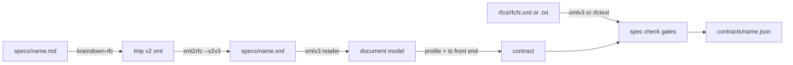

## Context

Today a spec is custom markdown with hand-numbered headings ([specs/example-hex.md](specs/example-hex.md)) and the contract beside it is hand-written ([contracts/example-hex.json](contracts/example-hex.json)). vector never calls a model (bdb9543 removed the model-driven extract). This plan makes the spec → contract step a deterministic program: spec authors write kramdown-rfc, the standard IETF tools build RFC XML v3 (RFC 7991), both are committed, and `vector spec extract` turns the XML into a contract. One XML reader serves our own specs and every RFC published in v3 XML.

Base: `main` @ `bdb9543`. Baseline gates in a cloud container: `bun test` 620 pass / 24 skip (the live nish tests skip: the nish seed download is refused here) / 0 fail; `bun run coverage` lines 90.45%, functions 93.91%. The run must end at ≥ 91% lines.

The full original requirements are reproduced verbatim on the tracking issue; every stage worker must read them there. Where this plan and the requirements disagree, the plan's **Profile decisions** win (they settle what the requirements left open); otherwise the requirements win.

## Approach



- **Stages and dependencies.** Wave 1 runs in parallel: `xmlv3`, `ts-front`, `pipeline`, `sources`. Wave 2 starts when its inputs merge: `profile` (needs `xmlv3`, `ts-front`, `pipeline`), `linked-rfcs` (needs `xmlv3`, `sources`). Wave 3: `extract` (needs `profile`, `linked-rfcs`), `docs` (starts after `profile` merges, merges after `extract`), `ci` (starts after `extract` merges).
- **Interfaces between stages are pinned here** (below), so a wave-2 worker reads exactly what a wave-1 worker exported. A worker that has to change a pinned interface says so in its PR body.
- **The core does not know TypeScript.** The profile asks a front-end registry for the front end matching a sourcecode type prefix (`ts-`).
- **No new runtime or dev dependency** in [package.json](package.json). No model call, no `@anthropic-ai/sdk`.
- **`ci` touches `.github/workflows/**`**, a sensitive path: the merge gate escalates it to a human by design. Everything else merges autonomously.

## Profile decisions

These settle the choices the requirements left open. `pipeline` confirms each one survives kramdown-rfc 1.7.43 → xml2rfc 3.35.0 `--v2v3` and records the result in `test/fixtures/kramdown/SURVIVAL.md`; if one does not survive, `pipeline` picks the closest form that does, records it there, and `profile` and `extract` follow `SURVIVAL.md`.

| choice | decision |
|---|---|
| `contract` | from `<rfc docName="draft-<contract>-NN">`: strip `draft-` and the `-NN` revision. Must equal the XML file's basename, else refused. (Unknown front-matter keys never reach the XML, so a `vector-contract:` key cannot be read.) |
| `target.module` | first line of the `ts-interface` block: `// module: nish/hex`. Required. |
| DEFINITION requirement | a paragraph starting `Definition:` followed by `{: #R-ID}`; level `DEFINITION`, quote is the paragraph's plain text after `Definition: `. |
| quoted-RFC requirement | `> verbatim RFC text` lines, last line `> {{Section 2.2 of RFC5869}}`, then `{: #R-ID}` on the line after the blockquote → `<blockquote anchor="R-ID">` ending in `<xref section target>`. |
| implies | `implies(a, b)` (a TS call, so it lexes as TS). `==>` is refused. |
| concat (vector literals) | `concat(a, b, …)`; `‖` is refused. |
| command-vector `section` | the computed number of the section that holds the vector table. |
| `let` in properties | the arrow body may be a block: `{ const e = hexEncode(b); return e === e.toLowerCase(); }` → `{let:[{name:"e",value:…}], in:…}`. |
| forall bounds | `(b: u8[] /* 0..64 */)` length for bytes/string, value range for i32/u32; strings add an alphabet: `(t: string /* 0..32 hexdigit HEXDIGIT */)` with class names from `ALPHABET_CLASSES` or a JSON string literal whose characters are the alphabet in order (`/* 1..1 " \t\n\r!" */`). |
| clause titles | vector table header is exactly `Id \| Call \| Expected \| Covers \| Source \| Title` (Title cell is plain text, the clause `title` verbatim after plain-text rendering); property title follows an em-dash on the covers line: `// P-ENC-LEN covers R-ENC-LEN — two characters per byte`. A missing title is refused. |
| `allowSurvivors` | moved to a sidecar `contracts/<name>.survivors.json` (`{"allowSurvivors": [...]}`), which `extract` copies verbatim into the contract when present. The contract stays byte-identical; extract's inputs are the XML plus the optional sidecar. Owned by stage `extract`. |
| exclusion | the paragraph right after a requirement starting `Untested: <reason>`, optionally ending `Checked by: <where>` → `{section, quote, reason}` (schema shape; `quote` is the requirement's quote; `Checked by:` text stays in `reason`). |
| vector cells | Call and Expected must each be exactly one code span, else refused ("cell must be a single code span"). |

## Pinned interfaces

```ts
// src/rfc/xmlv3.ts  (stage xmlv3)
export interface Loc { xmlLine: number; mdLine?: number }       // mdLine from nearest preceding <?line N?>
export interface XmlNode { name: string; attrs: Record<string,string>; children: (XmlNode|XmlText)[]; loc: Loc }
export interface XmlText { text: string; loc: Loc }
export interface V3Document extends RfcDocument {                 // RfcDocument from rfctext.ts, so gates consume it unchanged
  title: string; docName?: string; root: XmlNode;
  references: { anchor: string; rfc?: number; loc: Loc }[];
  sectionByAnchor: Map<string, string>;                           // anchor -> computed number
  normative: { section: string; level: Level; sentence: string; loc: Loc; anchor?: string }[];
}
export class XmlRefusal extends Error { loc: Loc }
export function parseV3(text: string, file: string): V3Document;   // throws XmlRefusal
export function plainText(node: XmlNode): string;                  // the documented rendering rule
export function isV3Xml(text: string): boolean;

// src/rfc/front/index.ts  (stage ts-front)
export interface FrontRefusal { message: string; line: number; col: number } // line/col relative to the block's first line
export interface FrontEnd {
  parseInterface(text: string): { module: string; functions: FnSig[] } | { refusals: FrontRefusal[] };
  parseProperty(text: string, fns: FnSig[]): { id: string; title?: string; covers: string[]; clause: Omit<PropertyClause,"id"|"title"|"covers"|"kind"> } | { refusals: FrontRefusal[] };
}
export function frontEndFor(sourcecodeType: string): FrontEnd | undefined; // "ts-interface" -> ts front end

// src/rfc/sources.ts  (stage linked-rfcs)
export class MissingRfcFile extends Error { rfc: number; hint: string }  // hint = the curl command(s)
export interface LoadedSource { decl: SourceDecl; file: string; sha256: string; doc: RfcDocument | V3Document }
export function loadSource(decl: SourceDecl, contractPath: string): LoadedSource; // throws MissingRfcFile
export function rfcDecl(n: number, contractPath: string): SourceDecl & { file: string; sha256: string };

// src/rfc/profile.ts  (stage profile)
export interface Refusal { file: string; line: number; col?: number; message: string } // line = markdown line when known, else XML line
export interface RfcResolver { (rfc: number): RfcDocument | V3Document }               // throws MissingRfcFile
export function profileToContract(doc: V3Document, xmlPath: string, resolve: RfcResolver): { contract: RfcContract } | { refusals: Refusal[] };
```

## Stage xmlv3

**Owns:** `src/rfc/xmlv3.ts`, `test/xmlv3.test.ts`, `test/fixtures/xmlv3/**`, `rfcs/rfc*.xml`, `THIRD_PARTY_NOTICES.md`, `test/notices.test.ts`

- Hand-written tokenizer: elements, attributes, text, CDATA, comments, processing instructions, character and the five predefined entities. No dependency.
- **Security.** Input is untrusted. A DOCTYPE is accepted only if its internal subset contains nothing but `<!ENTITY name "&#N;">` / `"&#xH;"` general entities with numeric values (xml2rfc writes `nbsp`, `zwsp`, `nbhy`, `wj`). Refused, each with its own message and line: external entity (`SYSTEM`/`PUBLIC` in an ENTITY), parameter entity (`<!ENTITY %`), a DOCTYPE with a SYSTEM or PUBLIC id, any other markup declaration, an undefined entity reference, `xi:include` with a non-empty `href`. Never fetch. Bounds: input size (e.g. 8 MiB) and nesting depth (e.g. 256), each a named constant with a refusal.
- **Sections.** Numbers as xml2rfc computes them: `<middle>` sections 1, 2, 2.1…; `<back>` sections A, B, A.1…; `numbered="false"` unnumbered (and their children); `<references>` sections, `<abstract>`, `<note>` and boilerplate skipped. Sections of the RfcDocument model keep the number as `id`, the `<name>` text as title.
- **Text.** `<t>`, `<blockquote>`, `<ul>/<ol>/<dl>` items, `<aside>`; inline `<bcp14>`, `<tt>`, `<em>`, `<strong>`, `<sub>`, `<sup>`, `<xref>`; `<figure>/<sourcecode type>`, `<artwork>`; `<table>/<thead>/<tbody>/<tr>/<th>/<td>`; `<references>/<reference anchor>/<seriesInfo name="RFC" value>`.
- **Plain text rule** (document it in the module header): entities resolved, inline markup stripped to its text, `<xref>` rendered as xml2rfc's text output renders it, whitespace runs collapsed to one space, trimmed — matching `normalizeText` in [src/rfc/rfctext.ts](src/rfc/rfctext.ts) so quotes compare the same way they do today.
- **Normative sentences.** Each element containing `<bcp14>` is split into sentences the way `normativeSentences` splits; every sentence containing a `<bcp14>` gets that keyword (from the markup, not a regex) as its level.
- **Line numbers.** Every node keeps its XML line and, from the nearest preceding `<?line N?>`, the markdown line.
- **Real RFC.** Pick a short v3 RFC with several BCP 14 sentences (≥ 8650), fetch `https://www.rfc-editor.org/rfc/rfc<N>.xml`, commit it unmodified under `rfcs/`. Test its section numbering, its `<bcp14>` sentences, and that quotes round-trip against `xml2rfc --text` output (commit the expected strings in the test, not the rendered .txt).
- **Notices** ([THIRD_PARTY_NOTICES.md](THIRD_PARTY_NOTICES.md)): add the RFC fixture's row; add kramdown-rfc and xml2rfc under "Used, not redistributed" after reading their actual license files (expected MIT and BSD-3-Clause; state what you found); find bib.ietf.org BibXML's terms and say what applies to the `<reference>` elements committed in spec XML. Keep `test/notices.test.ts` passing; extend it if it checks the RFC table.

## Stage ts-front

**Owns:** `src/rfc/front/**`, `test/front-ts.test.ts`

- Lexer + recursive-descent parser, hand-written. Comments are tokens where they carry meaning (`// module:`, `// P-ID covers …`, `/* lo..hi … */`).
- **Types** → contract types, exactly the set in [schemas/rfc-contract.json](schemas/rfc-contract.json) `paramType`/`returnType`: `u8[]`→bytes, `u8[] | null`→bytes?, `string`→string, `string | null`→string?, `i32`, `u32`, `boolean`→bool, `Secret<u8[]>`→secret-bytes, `Secret<u8[]> | null`→secret-bytes? (result only). Anything else refused naming the type.
- **ts-interface.** First line `// module: <module>`, then only `export const f = (a: T, b: U): R` or `export function f(a: T, b: U): R` lines (blank lines allowed). Duplicate names refused.
- **ts-property.** First line `// P-ID covers R-ID[, R-ID…]` (title per Profile decisions), then `forall (x: T /* … */, …) => expr` or a `{ const …; return …; }` body, optional following `where expr` line. Expressions: calls to interface functions; `x.length` → `len`/`strLen` by type; `=== null`/`== null` → `isNull`, `!== null`/`!= null` → `notNull`; `a.concat(b)` → `concat`, `a.slice(i, j)` → `slice`, `s.toLowerCase()`→`lower`, `s.toUpperCase()`→`upper`, `s.charAt(i)`→`charAt`, string `+` → `strConcat`; `+ - * %`, comparisons (`===`/`!==` as `==`/`!=`), `&& || !`; `implies(a, b)`; plain-call ops `xor bitAnd bitOr fill zeros flipBit le64 unwrap utf8 ascii`; literals as in the vector table.
- **Type check** every expression with `typeOf`/`assignable` from [src/rfc/contract.ts](src/rfc/contract.ts) against the interface signatures and forall variables. `where` may not call an interface function.
- **Refusals** name the construct and carry line and column: "`.map` is not in the ts-property subset", "unknown identifier `y`", "`hexEncode` expects u8[], got string", "missing `// P-ID covers R-ID` line", "`==>` is not in the ts-property subset; use implies(a, b)".

## Stage pipeline

**Owns:** `scripts/build-spec.sh`, `.refcache/**`, `test/build-spec.test.ts`, `test/fixtures/kramdown/**`, `.gitignore`

- `scripts/build-spec.sh <spec.md>` runs `kramdown-rfc spec.md > tmp.xml && xml2rfc --v2v3 tmp.xml -o spec.xml` and writes `<dir>/<name>.xml` beside the `.md`; then renders `xml2rfc --text` and `--html` to a temp dir and fails on any error.
- Pins kramdown-rfc 1.7.43 and xml2rfc 3.35.0 (or newer, with the reason in the script) and refuses to run if the installed versions differ, printing the `gem install kramdown-rfc -v …` / `pip install xml2rfc==…` lines.
- Reference cache: find whether kramdown-rfc honours `KRAMDOWN_REFCACHEDIR` (or similar) and point it at a committed `.refcache/`; commit the cache so the CI build is offline. Make it offline-strict if the tool allows (`KRAMDOWN_OFFLINE` or similar) — record what exists.
- `scripts/build-spec.sh --check <spec.md>`: rebuild to a temp file and compare with the committed XML after a canonicalization that removes only XML comments and processing instructions; print a unified diff and exit 1 on drift. Document the canonicalization in the script header.
- `test/fixtures/kramdown/profile.md` (+ built `.xml`): a small spec with a pinned `date:`, `{::boilerplate bcp14-tagged}`, a numbered middle, a `numbered="false"` section, an appendix, an anchored bcp14 paragraph, a Definition paragraph, an anchored blockquote quoting RFC 4648, an `Untested:` paragraph, a `ts-interface` and a `ts-property` block, and a vector table with backticked cells and `{{Section 10 of RFC4648}}` / `{{local-anchor}}` / code-span sources. `profile` uses this XML as its real-tool fixture.

## Stage sources

**Owns:** `schemas/rfc-contract.json`, `src/generated/**`, `contracts/**`, `src/rfc/contract.ts`, `src/rfc/frozen.ts`, `src/rfc/cli.ts`, `test/rfc.test.ts`, `test/read-checked.test.ts`, `test/rfc-sources.test.ts`

- `sourceDecl` gains optional `file` (repo-relative path of the bytes read, e.g. `rfcs/rfc4648.txt`) and `sha256` (hex of those bytes), with descriptions. Regenerate with `bun run generate:schemas`. Mirror in `SourceDecl` and `validateContractShape`.
- `vector spec check` verifies each declared `sha256` against the file it actually reads; a mismatch is a check failure naming the source.
- `frozenCheck` reports a changed RFC file the same way it reports a changed spec.
- Add `sources` with `file` + `sha256` to [contracts/rfc5869-hkdf-sha256.json](contracts/rfc5869-hkdf-sha256.json) and [contracts/rfc8439-chacha20-poly1305.json](contracts/rfc8439-chacha20-poly1305.json) (hand edit, keeping `source.rfc` semantics working), and `file` + `sha256` on the rfc4648 entry of [contracts/example-hex.json](contracts/example-hex.json). All three stay `CONTRACT_VALID`.

## Stage linked-rfcs

**Owns:** `src/rfc/sources.ts`, `src/rfc/frozen.ts`, `src/rfc/contract.ts`, `src/rfc/gates.ts`, `src/rfc/spectext.ts`, `src/rfc/rfctext.ts`, `src/rfc/cli.ts`, `test/rfc-linked.test.ts`, `test/fixtures/linked/**`, `test/rfc-gates.test.ts`, `test/rfc-spec.test.ts`, `test/rfc.test.ts`, `test/read-checked.test.ts`

- `sourceFile` looks for `rfc<N>.xml` then `rfc<N>.txt` at each place in the existing order (beside the contract, `../rfcs/`, vector's `rfcs/`), under the same `sourcePathProblem` rules.
- `src/rfc/sources.ts` owns loading (moved out of `cli.ts` ~line 200–240): `.xml` (or `isV3Xml`) → `parseV3`, else `parseDocument`.
- Gates on a V3Document: section existence by computed number; quotes and vector bytes verbatim against the cited section's plain text exactly as today; completeness for an XML main source reads `V3Document.normative` (keyword from markup). Contracts whose main source is an RFC `.txt` keep today's behaviour.
- `MissingRfcFile`: message `rfc<N> not found; fetch it: curl -sSfL -o rfcs/rfc<N>.xml https://www.rfc-editor.org/rfc/rfc<N>.xml` for N ≥ 8650, `.txt` for N < 8650, and both (let the user pick) for 8650 ≤ N < 8700. `spec check` exits 2 on it.

## Stage profile

**Owns:** `src/rfc/profile.ts`, `src/rfc/literals.ts`, `src/rfc/xmlv3.ts`, `src/rfc/front/**`, `test/profile.test.ts`, `test/fixtures/profile/**`

- Implements `profileToContract` per the requirements' §3 table and the Profile decisions. Collects **all** refusals before returning; each has file:line (markdown line when the XML carries `<?line?>`).
- Sources: the spec itself `{id: <contract>, path: "../specs/<name>.xml"}` as main; each `<reference anchor="RFCnnnn">` with `<seriesInfo name="RFC">` that a requirement or vector cites → `{id: "rfcnnnn", rfc: nnnn}` (file/sha256 are filled in by `extract`). Uncited informative references need no file and produce no source.
- Every `<xref target="RFCnnnn">` anywhere must match a `<reference>`; every cited section must exist in the resolved RFC (through `RfcResolver`).
- Vector cells: Call is one call to an interface function with literal args; Expected is a literal. Literals: `"…"` JSON string, `[00 0f f0 ff]` bytes (lowercase hex pairs, single spaces), `[]` and `(empty)` empty bytes, `null`, `true`/`false`, decimal integers, `Label = 0b0b…` labelled hex, `concat(a, b)`. The callee's declared type decides meaning: `"f"` where bytes are expected → `{ascii:"f"}`, where string → `{str:"f"}`; reproduce [contracts/example-hex.json](contracts/example-hex.json)'s exact literal forms. A literal the types do not settle is refused.
- Covers: comma-separated, each id must exist. Source: `{{Section N of RFCx}}` → `{cite:{source,section}}`; `{{anchor}}` → `{cite:{section}}` for a printed value, `{spec: <number>}` for an expected null/bool (the provenance gate in [src/rfc/gates.ts](src/rfc/gates.ts) then checks the quote states it — reuse by running the gate, do not re-implement); a cell that is only a code span → `{command}` plus `section` = the table's section; anything else refused.
- Bug fixes to `xmlv3.ts` or `front/**` that profile needs are in scope here; say so in the PR body.

## Stage extract

**Owns:** `src/rfc/cli.ts`, `src/rfc/extract.ts`, `src/cli.ts`, `specs/**`, `contracts/example-hex*.json`, `test/**`

- `vector spec extract specs/<name>.xml [-o contracts/<name>.json] [--check]`. A `.md` argument → exit 2 `build it first: scripts/build-spec.sh specs/<name>.md`; never shells out. No `-o` → stdout. `--check` → exit 1 with a unified diff if the `-o` file differs.
- Exit codes: 0 written / up to date; 1 refusals, all at once, each `file:line: message`; 2 usage, unreadable/missing file, `MissingRfcFile` (with the curl hint).
- Fills each RFC source's `file` and `sha256` via `rfcDecl`, the main `source.sha256` from the XML bytes, then runs the same gates as `spec check` (without `--run-sources`) and refuses on any failure.
- Canonical output: keys in schema property order (document the order in `extract.ts`), 2-space indent, `\n`, trailing newline. Same XML → same bytes.
- Port [specs/example-hex.md](specs/example-hex.md) to kramdown-rfc: `{::boilerplate bcp14-tagged}`, unnumbered headings giving Introduction 1, Interface 2, Encoding 3 (3.1, 3.2), Decoding 4 (4.1–4.4), Security Considerations 5, Test Vectors 6 (middle, not appendix), `normative: RFC4648:`, pinned `date:`. Every normative sentence word for word. Build `specs/example-hex.xml` with `scripts/build-spec.sh`.
- Create `contracts/example-hex.survivors.json` from the contract's current `allowSurvivors`; extract merges it.
- `extract … --check` must pass against [contracts/example-hex.json](contracts/example-hex.json) with only these changes: the new `file`/`sha256` source fields, the spec source `path` `.md` → `.xml`, `source.sha256` of the XML. Any other change is justified field by field in the PR body. Never edit the expected contract to pass without that.
- Keep reading the old custom-markdown format (the old `--spec *.md` path in `check` still works).
- Update `rfcMain` usage, [src/cli.ts](src/cli.ts) usage and the tests pinning usage text. Existing tests that read `specs/example-hex.md` as custom markdown move to a frozen copy under `test/fixtures/` or onto the XML.

## Stage docs

**Owns:** `README.md`, `.claude/skills/vector-spec/**`

- README: replace the spec-format section with **Writing a spec (kramdown-rfc)**: the pipeline diagram (`spec.md → kramdown-rfc → xml2rfc --v2v3 → spec.xml → vector spec extract → contract.json`), the profile table (as merged, from `SURVIVAL.md` and `profile.ts`), literal and type rules, linked-RFC rules, the edit loop (edit `.md`, `scripts/build-spec.sh`, `vector spec extract`, commit all three), installing the pinned tools.
- SKILL.md: the skill drafts the kramdown-rfc spec (prose + profile blocks), runs the build script and `extract`, never writes a contract by hand; the reviewer at spec approval confirms each `ts-property` says what its sentence says and each `Untested:` reason is true; keep the PR workflow (`frozen`, `stale`, `exports`, `mutate`) with updated commands.
- Write against the merged `profile` code; if `extract` changes a command after this opens, update in the same PR before merge.

## Stage ci

**Owns:** `.github/workflows/**`
**Model:** sonnet

- New job `spec-xml-drift`: setup Ruby and Python, `gem install kramdown-rfc -v 1.7.43`, `pip install xml2rfc==3.35.0`, then `scripts/build-spec.sh --check` for every `specs/*.md`, offline against the committed `.refcache/`.
- In the `check` job, after tests: `bun src/cli.ts spec extract specs/<name>.xml -o contracts/<name>.json --check` for every `specs/*.xml`.
- Sensitive path: this PR is escalated to a human at the gate by design.

## Out of scope

- Porting `contracts/rfc5869-hkdf-sha256.json` and `contracts/rfc8439-chacha20-poly1305.json` to extracted contracts (a later PR); here they only gain `sources` file/sha256.
- Removing the custom-markdown reader (the next PR).
- How RFC-main-source profiles account for an RFC's own sentences (prompt 2).
- Any change to coverage, lint or typecheck configuration.

## Tests

- **xmlv3** (`test/xmlv3.test.ts`): numbering incl. back matter and `numbered="false"`; bcp14 sentences incl. several per paragraph; `<?line?>` mapping; plain text; DOCTYPE accepted (xml2rfc's set) and refused (external entity, parameter entity, SYSTEM id, `xi:include` href); depth and size bounds; the real RFC.
- **ts-front** (`test/front-ts.test.ts`): every type and expression mapping; every refusal with line and column.
- **pipeline** (`test/build-spec.test.ts`): runs the build + `--check` on the fixture only if the pinned tools are on PATH, and logs that it skipped otherwise.
- **sources** (`test/rfc-sources.test.ts`): new fields validate; sha mismatch fails check; frozen flags a changed RFC.
- **linked-rfcs** (`test/rfc-linked.test.ts`): xml preferred over txt; path safety holds for `.xml`; missing RFC → `MissingRfcFile` with the right curl form per N; gates on XML sources.
- **profile** (`test/profile.test.ts`): one fixture per construct, plus refusals — bcp14 sentence with no anchor and no exclusion; unknown Covers id; uncited and unreferenced RFC xref; nonexistent section; missing RFC file; literal the types do not settle; table cell without backticks; two `ts-interface` blocks; `ts-property` without a covers line.
- **extract** (`test/rfc-extract.test.ts`): example-hex end to end (`--check` passes, two runs byte-identical); `.md` argument → exit 2 with the hint; missing RFC file → exit 2 with the curl hint; refusals → exit 1 listing all with file:line.

## Verification

```
bun test
bun run typecheck
bun run lint
bun run coverage          # lines ≥ 91% at the end of the run
bun src/cli.ts spec extract specs/example-hex.xml -o contracts/example-hex.json --check
bun src/cli.ts spec check contracts/example-hex.json --spec specs/example-hex.xml --run-sources
bash scripts/build-spec.sh --check specs/example-hex.md
```
